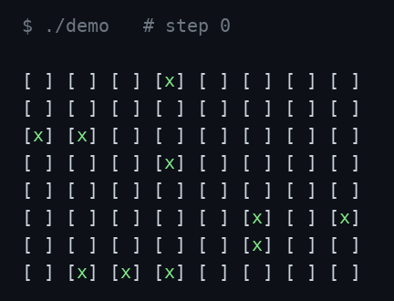
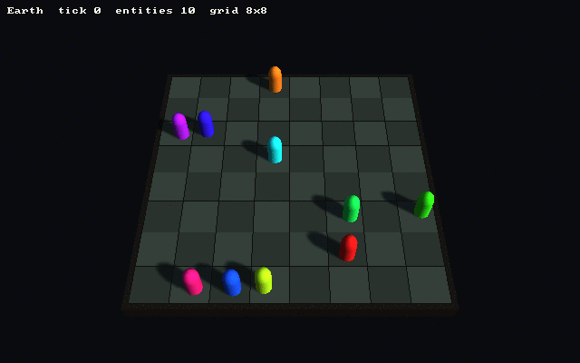
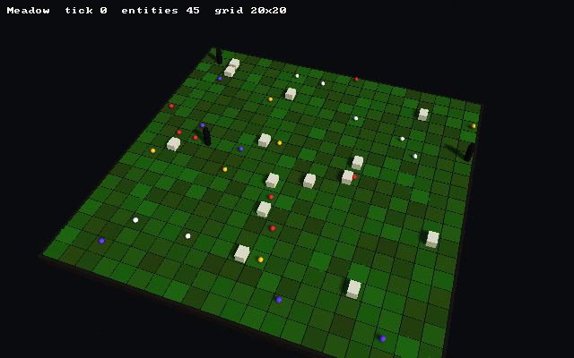

# environment-lib-cpp
This C++ library provides base classes for creating 2D virtual worlds.



*Ten entities moving to random adjacent locations in an 8x8 `Environment`; each frame is the library's own `printConsoleRepresentation()` output (`x` marks an occupied location). Recorded from [`docs/demo.cpp`](docs/demo.cpp) by `bash docs/capture.sh` (needs g++ and Python with Pillow).*

## A 3D view (optional, on Strata)



*The README's random walk again (`docs/demo.cpp`, seed 7), drawn by the opt-in Strata frontend in [`strata/`](strata/): one capsule per entity, sliding between cells between ticks.*



*A larger demo world (`--world meadow`): sheep graze and wander, wolves stalk the nearest sheep, flowers stay put. The grass under each location is the demo's own state, shown as the floor colour.*

The frontend reads an `Environment` and draws it with the [Strata](https://github.com/Preponderous-Software/strata) engine (v0.6.0). It never changes the world: CI runs each demo with and without drawing and compares the results. A consumer writes one callback that turns an `Entity` into a shape, colour and size; everything else (floor, camera, tweening, picking a location with the mouse, a HUD) is provided. It is opt-in and built separately with CMake, so the library above still needs nothing but a C++ compiler. See [docs/STRATA.md](docs/STRATA.md).

```
cmake -S strata -B build-strata -DCMAKE_BUILD_TYPE=Release
cmake --build build-strata -j4
build-strata/envlib_strata_demo --world meadow
```

Both demo worlds also build for the browser (Emscripten, Strata's WebGL 2 backend); see [docs/STRATA.md](docs/STRATA.md#in-a-browser).

## Classes
Name | Description
----- | -----
Entity | Represents an entity that can exist in a location.
Environment | Represents a virtual environment with an underlying 2D grid of locations that can contain entities.
Grid | Represents a grid of locations.
Location | Represents a location that can contain entities.

Entities exist in locations. Locations exist in grids. Grids exist in environments. Environments serve as the interface for developers to affect the locations and entities within.

## Ownership and Lifetime

The library does not own the entities placed in it. `Environment::addEntity`, `addEntityToLocation`, and `removeEntity` take an `Entity&`, and a `Location` stores the address of that object in a `std::vector<Entity*>`. Nothing in the library ever allocates or deletes an `Entity`. The caller must therefore keep each `Entity` alive, and at a stable address, for as long as it is present in an environment; destroying it, or letting its address change (for example by storing entities in a `std::vector<Entity>` that later reallocates), leaves a dangling pointer in its location.

An `Environment` owns its `Grid`. The grid is allocated in the `Environment` constructor and deleted in its destructor. `Environment::getGrid()` returns that same pointer for inspection and must not be deleted by the caller.

`Environment`'s copy constructor and copy assignment operator are deleted, since a copy would share the original's `Grid*` and both would delete it on destruction. Copying or assigning an `Environment` is therefore a compile error; pass it by reference or by pointer instead.

A `Grid` stores its locations by value in a `std::vector<Location>`. `Grid::getLocation`, `getLocationByCoordinates`, `getFirstLocation`, and `getRandomLocation` return a `Location&` into that vector, so any such reference may be invalidated by a later call to `Grid::addLocation` or `Grid::removeLocation`. `addLocation` also stores a copy of its argument; the grid subsequently operates on the copy, not on the caller's original object.

## Grid Layout and Movement

`Environment(id, name, size)` creates a square grid of `size` × `size` locations. The grid is given the environment's own `id`, and each location's id has the form `<gridId>-<x>-<y>` (for example `0-2-1`). Locations are generated row by row, with `x` and `y` each running from `0` to `size - 1`; `Grid::getLocations()` and `Environment::printConsoleRepresentation()` follow that order.

`Environment::addEntity` (and `Grid::addEntity`) places the entity in a location chosen by `Grid::getRandomLocation()`, not in the first location. To place an entity at a specific location, use `addEntityToLocation`.

`addEntityToLocation` uses its `location` argument only for its id: the entity is added to the grid's own location with that id. The argument may therefore be either a reference obtained from the grid (for example from `getLocation` or `getLocationByCoordinates`) or a separately constructed `Location` with a matching id; in the latter case the separate object is left unchanged.

`Grid::setSize` and `Grid::setId` only overwrite the stored value. Neither regenerates the grid's locations nor renames their ids, so after either call `getSize()` or `getId()` no longer describes the existing locations. `printConsoleRepresentation()` breaks rows every `getSize()` locations, so it misaligns after `setSize`.

`y` increases downward: `moveEntityUp` moves an entity to `y - 1`, `moveEntityDown` to `y + 1`, `moveEntityLeft` to `x - 1`, and `moveEntityRight` to `x + 1`. The grid does not wrap. A move that would leave the grid returns `false` and leaves the entity where it was; a successful move returns `true`. `moveEntityToRandomAdjacentLocation` picks one of the same four directions with `rand()`, so it also returns `false` whenever the chosen direction points off the grid. The library never calls `srand()`; seeding is left to the caller.

## Entity Identity

Entities are matched by `Entity::getId()`, not by address. `Location::isEntityPresent`, `Location::removeEntity`, and `Environment::getEntity` all compare ids, so two distinct `Entity` objects that share an id are treated as the same entity. Entity ids should therefore be unique within an environment.

A newly constructed entity has an environment id and grid id of `-1` and a location id of `"N/S"`. Placing it through an `Environment` sets all three; `Environment::removeEntity` resets them to those same values.

`Environment::removeEntity` and `Grid::removeEntity` do nothing when the entity is not present. Calling either on an entity that is not in that environment or grid — including one placed in a different environment — leaves its environment id, grid id, location id, and actual placement unchanged. `Location::removeEntity` likewise leaves the location id of an entity that is not in that location unchanged.

Adding is likewise unchecked. `addEntity` and `addEntityToLocation` do not test whether the entity is already present, so adding it a second time stores a second pointer to it (in another location, or in the same one), its location id names only the most recent location, and `getNumEntities` counts it twice. To relocate an entity that is already placed, use `moveEntityToNewLocation` or one of the directional move methods, which remove it before adding it again.

`Grid::removeLocation` also detaches any entities in the removed location: it resets their location id to `"N/S"` and their grid id to `-1`. It leaves their environment id unchanged, since the grid has no knowledge of its environment.

## Errors

Lookups that find nothing throw `std::runtime_error`:

- `Environment::getFirstEntity`, when the environment contains no entities.
- `Environment::getEntity`, when no entity has the given id. The message lists the ids that were found.
- `Grid::getLocation` and `Grid::getLocationByCoordinates`, when no location matches.

`Environment::moveEntityToNewLocation` looks up both the entity and the destination before moving anything, so an unknown entity id or location id throws and leaves the entity in place. The directional move methods catch the off-grid case and return `false`, but still throw if `entityId` does not name an entity in the environment.

`addEntityToLocation` does not throw when no grid location has the given location's id. The entity is then placed nowhere, and its grid id, environment id, and location id are left unchanged.

`Grid::getFirstLocation` and `Grid::getRandomLocation` do not check for an empty grid. Calling either on a grid with no locations — including indirectly through `Environment::addEntity` on an environment of size `0` — is undefined behaviour.

## Building

A C++ compiler (`g++`) and `make` are the only prerequisites.

```
make
```

The default target, `all`, depends on the only other target, `tests`. It compiles every `.cpp` file in `src/` — the four class implementations plus the test suite — into a `tests_executable` binary at the repository root.

A `CMakeLists.txt` builds the same four sources as the static library target `envlibcpp` (alias `envlibcpp::envlibcpp`, with `src/header/` as its include directory) and the test suite as a CTest test:

```
cmake -S . -B build && cmake --build build && ctest --test-dir build
```

A CMake project can use it with `add_subdirectory()` or `FetchContent`. No install, packaging, or shared-library target is defined. A project that does not use CMake therefore compiles `src/entity.cpp`, `src/environment.cpp`, `src/grid.cpp`, and `src/location.cpp` alongside its own sources and includes the headers from `src/header/`. `src/tests.cpp` is excluded, since it defines its own `main()`.

`tests_executable`, along with the `tests_executable_asan` binary built by `run_tests_asan.sh`, is listed in `.gitignore` and is never committed.

## Running Tests

The test suite lives in `src/tests.cpp` as a set of `assert()`-based functions registered in `main()`. A failing assertion aborts the process, so a nonzero exit status means the suite failed.

```
bash run_tests.sh
```

`run_tests.sh` is the canonical gate: it deletes any previous binary, runs `make`, and executes the result. This script is expected to pass before a change is merged.

```
bash run_tests_asan.sh
```

`run_tests_asan.sh` is the AddressSanitizer variant. It compiles the same sources with `-fsanitize=address -g` into `tests_executable_asan` and runs it with `ASAN_OPTIONS=detect_leaks=1`, so an unfreed allocation or a memory-safety error fails the run. Running it is additionally expected for any change that affects allocation or object lifetime.

## py_env_lib

This project is based on py_env_lib, the repository for which can be found [here](https://github.com/Preponderous-Software/py_env_lib).

## 📄 License

env-lib-cpp is licensed under the [MIT License](LICENSE).

Copyright © 2022–2025 Daniel McCoy Stephenson. All rights reserved.

Permission is hereby granted, free of charge, to any person obtaining a copy of this software 
and associated documentation files (the “Software”), to deal in the Software without restriction, 
including without limitation the rights to use, copy, modify, merge, publish, distribute, sublicense, 
and/or sell copies of the Software, and to permit persons to whom the Software is furnished to do so, 
subject to the following conditions:

The above copyright notice and this permission notice shall be included in all copies 
or substantial portions of the Software.

THE SOFTWARE IS PROVIDED “AS IS”, WITHOUT WARRANTY OF ANY KIND, EXPRESS OR IMPLIED, INCLUDING BUT 
NOT LIMITED TO THE WARRANTIES OF MERCHANTABILITY, FITNESS FOR A PARTICULAR PURPOSE AND NONINFRINGEMENT. 
IN NO EVENT SHALL THE AUTHORS OR COPYRIGHT HOLDERS BE LIABLE FOR ANY CLAIM, DAMAGES OR OTHER LIABILITY, 
WHETHER IN AN ACTION OF CONTRACT, TORT OR OTHERWISE, ARISING FROM, OUT OF OR IN CONNECTION WITH THE 
SOFTWARE OR THE USE OR OTHER DEALINGS IN THE SOFTWARE.

---

### Why MIT?
The **MIT License** was chosen for its simplicity and permissiveness, ensuring that developers across industries—whether in games, simulations, or research—can freely adopt and extend **env-lib-cpp**. This fosters collaboration, encourages integration with other languages and tools, and helps establish it as a go-to C++ foundation for environment simulation.

### Open Source Commitment
There are **no plans to move away from open source** for **env-lib-cpp**. The library will remain freely available under an OSI-approved license, and contributions from the community are welcomed.
