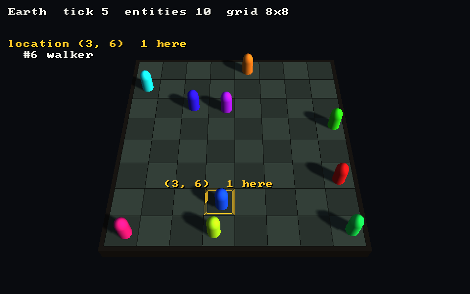

# env-lib-cpp in 3D, on Strata

`strata/` is an opt-in 3D frontend for env-lib-cpp, drawn with the
[Strata](https://github.com/Preponderous-Software/strata) engine. It follows
RFC 0029 in [Preponderous-Software/rfcs](https://github.com/Preponderous-Software/rfcs).
It reads an `Environment` and never changes it.



Nothing in the library depends on it. `make`, `run_tests.sh` and the top-level
`CMakeLists.txt` do not build it.

## Build and run

CMake 3.24 or newer (Strata's minimum), a C++17 compiler, and the SDL3 build
dependencies Strata needs on Linux (X11 development headers, EGL). Strata is
fetched at the commit in `strata/strata.ref`, which is the `v0.6.0` release.

```
cmake -S strata -B build-strata -DCMAKE_BUILD_TYPE=Release
cmake --build build-strata -j4
ctest --test-dir build-strata --output-on-failure
build-strata/envlib_strata_demo                  # the walkers, in a window
build-strata/envlib_strata_demo --world meadow   # sheep, wolves and flowers
```

To build against a local Strata checkout, add
`-DFETCHCONTENT_SOURCE_DIR_STRATA=<path>`.

Window controls: drag or WASD/arrows pan, Q/E rotate, mouse wheel or +/- zoom,
click picks a location (its entities are listed in the corner), space pauses,
N steps one tick while paused, `,`/`.` slower/faster, Tab toggles the HUD, Esc
quits.

Headless (no window; EGL surfaceless, so Mesa llvmpipe works without a
display: `LIBGL_ALWAYS_SOFTWARE=1 GALLIUM_DRIVER=llvmpipe`):

```
build-strata/envlib_strata_demo --world walkers --headless --ticks 20 --screenshot walkers.png
build-strata/envlib_strata_demo --world meadow --headless --ticks 60 --frames out/ --frames-per-tick 3
```

`bash docs/capture-3d.sh` records the images in `docs/media/`.

## Using it in a program

Link the `envlib_strata` target. The simplest program hands its environment
and its tick to `ViewerApp`:

```cpp
#include "envlib_strata/viewer_app.h"

std::list<envlibcpp::Entity> entities;  // stable addresses, as env-lib-cpp requires
envlibcpp::Environment env(0, "Earth", 8);
// ... add entities ...

envlib_strata::ViewerOptions options;
options.ticksPerSecond = 4;
envlib_strata::ViewerApp app(
    env,
    [&] { for (auto& e : entities) env.moveEntityToRandomAdjacentLocation(e.getId()); },
    options,
    [](envlibcpp::Entity& e) {          // the style callback
        envlib_strata::Style s;
        s.primitive = e.getName() == "wolf" ? STRATA_PRIMITIVE_CAPSULE : STRATA_PRIMITIVE_CUBE;
        return s;
    });
return app.run();
```

When something else owns the loop (a browser, where the page must return to
the browser between frames), call `start()` once and `frame()` once per
callback instead of `run()`. `setWorld()` swaps in another environment on the
same engine, and `key()`, `zoom()`, `rotate()`, `home()`, `pickAt()` and
`status()` are what page buttons and a page's own text use. The browser build
below does exactly that.

A program that already has a Strata loop uses the two parts underneath:

| Part | Job |
|---|---|
| `EnvironmentView` | `sync(env)` copies each entity's id, name, cell and `Style`, and the optional floor colours. It keeps no `Entity*` or `Location&` past the call. |
| `Scene` | `updateFloor()` builds the floor as one static mesh (rebuilt only when the grid size or a floor colour changes). `buildItems(view, t)` gives one primitive per entity, tweened by `t` from its last cell to its current one. `buildGridLines()`, `buildCellOutline()` and `pick()` do the rest. |

Call `sync()` between ticks, on the thread that runs the simulation: env-lib-cpp
has no locking.

### Styles

`Style` is a primitive kind (cube, capsule, cylinder, sphere), a linear RGB
colour, a scale in world units (a cell is 1.0) and a lift above the floor. The
default style is a cube whose hue is a hash of the entity's name, so entities
of one kind share a colour. Colours are **linear**, as Strata expects; convert
sRGB values (CSS hex codes, most 2D palettes) with `srgbToLinear()`.

The callback takes `Entity&`, not `const Entity&`, only because env-lib-cpp's
getters are not `const`. The frontend calls getters only.

A second, optional callback, `LocationColorFn`, gives each location a floor
colour (the meadow's grass).

## How the world maps to 3D

- env-lib `x` is Strata +X and env-lib `y` is Strata +Z (Strata is Y-up). The
  grid is centred on the origin. env-lib's `y` grows downward, so row 0 is the
  far edge seen from the default camera.
- Several entities in one location are spread inside it by a fixed offset from
  a hash of the entity's id (at most 0.2 of a cell each way), so an entity keeps
  its place in a shared cell from frame to frame.
- Between ticks an entity slides from its last cell to its new one. A move of
  more than one cell (`moveEntityToNewLocation`, or a new random placement)
  snaps.
- Picking uses Strata's mesh raycast against the floor. Strata does not test
  primitives, so a click picks a **location** and lists its entities, rather
  than picking one entity.

## In a browser

The same `ViewerApp` builds with Emscripten against Strata's WebGL 2 backend
(emsdk 6.0.11, Strata's pin). `strata/web/web_main.cpp` hands its frame to
`emscripten_set_main_loop`, and `strata/web/shell.html` is the page: a button
per demo world (walkers, meadow), a status line, the picked location's
entities, and buttons for what keys do on the desktop (pause, step, slower,
faster, turn, zoom, home, HUD). Drag pans, the wheel or a two-finger pinch
zooms, and a click or tap picks a location.

```
source <emsdk>/emsdk_env.sh
emcmake cmake -S strata -B build-web -DCMAKE_BUILD_TYPE=Release
cmake --build build-web -j4
ctest --test-dir build-web --output-on-failure   # the view tests, under Node
cd build-web && python3 -m http.server 8000      # open /envlib-strata.html
```

`?world=meadow` (or `walkers`) in the URL picks the first world. The render
tests and the desktop demo are not built for the browser (no EGL, and the
desktop loop never returns). `.github/workflows/browser.yml` builds the page,
runs the view tests as wasm, and smoke-tests it in headless Chromium on a
desktop and an iPhone 13 profile (`strata/web/smoke/smoke.cjs`: both worlds
tick and draw, Pause and Step, and a real click or tap picks the location
under it).

## Tests

- `[view]`: the copy, the no-pointer rule (an entity freed after `sync()`), an
  id seen in two places, styles, floor colours, the axes, fan-out and tweening,
  and that the demo worlds reach the same state with and without drawing.
- `[render]` (needs EGL + GL 4.5): the walkers world rendered headlessly and
  compared with `strata/test/golden-walkers-seed7.txt` (16x10 block averages,
  so small rasteriser differences pass and a moved grid or missing entity does
  not); picking each of several cells; the floor mesh rebuilt only on change.
  After a deliberate change to the look, regenerate the golden file with
  `ENVLIB_STRATA_WRITE_GOLDEN=1 build-strata/envlib_strata_tests "[render]"`.
- CI also runs both demo worlds with `--state` (no rendering) and headless, and
  requires the same state hash.

## Not yet

- **Picking one entity** among several in a location, and **instancing a custom
  mesh** per entity kind, would each need a Strata change first (primitive
  raycasts; instanced meshes). Neither is needed today.
- **py_env_lib** is out of scope (RFC 0029, section 7).
